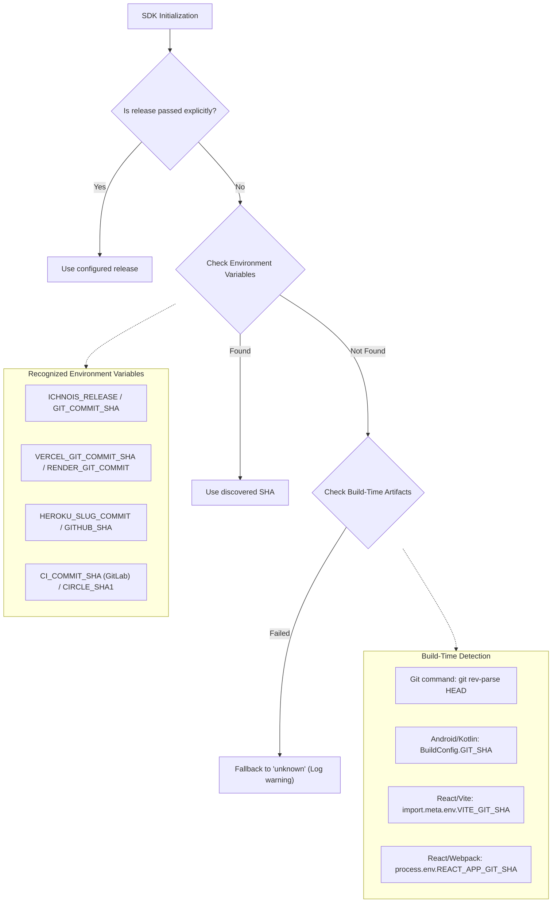
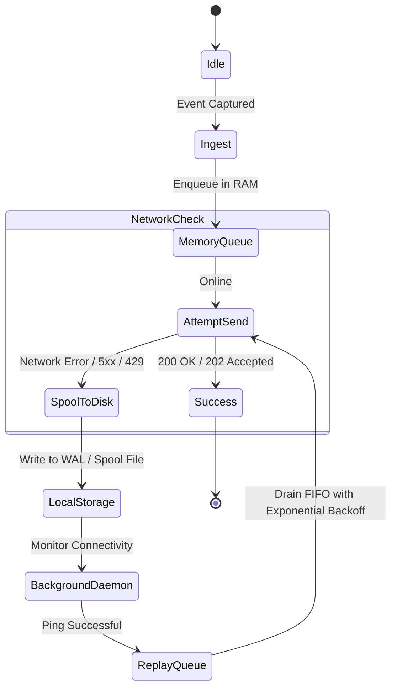

# 🌐 Universal Ichnois SDK Specification & Implementation Guide

> **Status**: Official Engineering Standard (v1.0.0)  
> **Target Audience**: SDK Authors implementing Ichnois for any runtime (Kotlin, React/JS, Python, Go, Rust, Swift, .NET, etc.)  
> **Backend Service**: Ichnois Core Ingestion Gateway (`Ichnoscope-WCC-30`)  
> **Production Ingest URL**: `https://ichnois-h2jw.onrender.com`  
> **Core Objective**: Define a single, universal, cross-language blueprint so that every language SDK connects seamlessly to the live Ichnois backend with identical wire protocols, payload schemas, offline persistence, and developer ergonomics.

---

## 1. Architectural Philosophy & Golden Rules

Every Ichnois SDK, regardless of language or runtime, must adhere to these four golden rules:

1. **Wire-Protocol Invariance**: The backend ingestion route is fixed:
   `POST {host}/api/{project_id}/envelope/` (fallback: `/api/{project_id}/store/`).  
   SDKs must **never** invent ad-hoc endpoints (no `/v1/ingest/` or raw OTLP collectors).
2. **Deterministic Payload Schema**: Every crash payload must contain the exact structure expected by the backend parser (`ichnoscope/parse.py`):
   - A valid Git commit SHA in `release` (for automated Git Blame).
   - Properly classified `in_app` frames (crashing application frame at the end of stack).
   - Valid `event_id`, `timestamp`, and `exception.values`.
3. **Resilient Local Persistence**: SDKs must never discard telemetry on network failure. In-memory queues must be backed by a persistent Write-Ahead Log (WAL) or embedded storage (SQLite, IndexedDB, AsyncStorage, file spool) with automatic replay on reconnect.
4. **Developer Ergonomics**: A consistent, intuitive public API (`Ichnois.init()`, `Ichnois.captureException()`, etc.) tailored to each language's idiomatic conventions (camelCase in TS/Kotlin, snake_case in Python/Rust, PascalCase in C#).

```mermaid
flowchart TD
    subgraph HostApp ["Host Application Environment"]
        UserCode["App / User Code"] --> API["Universal Public API (Ichnois.init / captureException)"]
        API --> Pipeline["Error & Context Normalizer"]
        Pipeline --> ScopeMgr["Scope & Context Manager (Global / Request / Span)"]
        ScopeMgr --> Enveloper["NDJSON Envelope Formatter"]
    end

    subgraph ResilienceLayer ["Resilience & Offline Layer"]
        Enveloper --> SpoolCheck{"Network Available?"}
        SpoolCheck -->|No / 5xx / 429| PersistentStorage[("Local Persistent Spool (Disk/DB)")]
        SpoolCheck -->|Yes| Transport["HTTP/2 & HTTP/1.1 Transport (Gzip compressed)"]
        PersistentStorage -->|Background Replay| Transport
    end

    subgraph ProductionBackend ["Ichnois Live Backend (Server B)"]
        Transport -->|POST /api/{project_id}/envelope/| IngestionGateway["Ingress: ichnois-h2jw.onrender.com"]
        IngestionGateway --> Parser["ichnoscope/parse.py"]
        Parser --> BlameEngine["GraphQL Release-SHA Git Blame"]
        BlameEngine --> AIOrchestrator["Dual-Gate Issue Remediator"]
    end
```

---

## 2. Ingestion Protocol & Network Specification

### 2.1 Endpoint Resolution
The SDK resolves ingestion endpoints using either a **DSN string** or a **structured configuration object**.

#### Option A: Standard Ichnois DSN (Recommended)
```
https://{public_key}@{host}[:{port}]/api/{project_id}
```
*Example*:
`https://0190a2c3d4e5f6@ichnois-h2jw.onrender.com/api/checkout-service`

*Parsed Components*:
- `host`: `ichnois-h2jw.onrender.com`
- `project_id`: `checkout-service`
- `public_key`: `0190a2c3d4e5f6`
- **Resulting Endpoint URL**: `https://ichnois-h2jw.onrender.com/api/checkout-service/envelope/`

#### Option B: Structured Configuration Object
```json
{
  "endpoint": "https://ichnois-h2jw.onrender.com",
  "project_id": "checkout-service",
  "api_key": "0190a2c3d4e5f6",
  "environment": "production",
  "release": "4f8b2a1"
}
```
*Internal Translation*: The SDK automatically constructs:
`{endpoint}/api/{project_id}/envelope/`

### 2.2 HTTP Transmission Request
All SDKs must dispatch envelopes using standard HTTP POST requests:

```http
POST /api/{project_id}/envelope/ HTTP/1.1
Host: ichnois-h2jw.onrender.com
Content-Type: application/x-sentry-envelope
Content-Encoding: gzip
User-Agent: ichnois.{language}/{sdk_version}
X-Sentry-Auth: Sentry sentry_key={public_key}, sentry_version=7, sentry_client=ichnois.{language}/{sdk_version}

<Gzip-compressed NDJSON Envelope payload>
```

- **Compression**: Payloads should be compressed with `gzip` (or `deflate`). Payloads $<512$ bytes may be sent uncompressed with `Content-Encoding` omitted.
- **Header Fallback**: If custom headers are stripped by enterprise firewalls, the DSN in Line 1 of the envelope header ensures the backend can still authenticate the project.

---

## 3. Envelope Wire Format (NDJSON)

Envelopes are formatted as Newline-Delimited JSON (NDJSON). Each section ends with a newline character (`\n`):

```text
Line 1: Envelope Header JSON \n
Line 2: Item Header JSON \n
Line 3: Item Payload (Event JSON) \n
```

### 3.1 Line 1: Envelope Header
```json
{
  "event_id": "4b66df87274047a09d0d20d82992ef1b",
  "sent_at": "2026-10-25T14:30:00.000Z",
  "dsn": "https://0190a2c3d4e5f6@ichnois-h2jw.onrender.com/api/checkout-service"
}
```

### 3.2 Line 2: Item Header
```json
{
  "type": "event",
  "content_type": "application/json"
}
```

### 3.3 Line 3: Item Payload (Event JSON)
The complete Event payload JSON object (specified in Section 4).

*(For multi-item envelopes such as session heartbeats or attachments, repeat Line 2 and Line 3).*

---

## 4. Mandatory Event Payload Schema

This payload format is parsed deterministically by `ichnoscope/parse.py`. Every SDK must construct event payloads adhering to this exact schema:

```json
{
  "event_id": "4b66df87274047a09d0d20d82992ef1b",
  "timestamp": 1792916100.0,
  "platform": "python",
  "level": "error",
  "environment": "production",
  "release": "4f8b2a1a2b3c4d5e6f7a8b9c0d1e2f3a4b5c6d7e",
  "server_name": "worker-node-04",
  "exception": {
    "values": [
      {
        "type": "NullPointerException",
        "value": "Attempt to invoke virtual method on a null object reference",
        "module": "java.lang",
        "stacktrace": {
          "frames": [
            {
              "filename": "com/ichnois/app/OrderService.kt",
              "abs_path": "/src/main/kotlin/com/ichnois/app/OrderService.kt",
              "function": "processCheckout",
              "lineno": 88,
              "colno": 14,
              "in_app": true,
              "context_line": "val total = cart.calculateTotal()",
              "pre_context": [
                "fun processCheckout(cart: Cart?) {",
                "    validateUser(cart.userId)"
              ],
              "post_context": [
                "    paymentGateway.charge(total)",
                "}"
              ]
            }
          ]
        }
      }
    ]
  },
  "tags": {
    "environment": "production",
    "service": "checkout-service",
    "git.commit": "4f8b2a1a2b3c4d5e6f7a8b9c0d1e2f3a4b5c6d7e"
  },
  "user": {
    "id": "usr_9912",
    "email": "customer@ichnois.io"
  },
  "contexts": {
    "trace": {
      "trace_id": "a1b2c3d4e5f67890123456789abcdef0",
      "span_id": "1234567890abcdef"
    }
  },
  "_ichnoscope": {
    "event_count": 1,
    "users_affected": 1
  }
}
```

### 4.1 Critical Field Specifications for Git Blame & Dual-Gate Triage

| Field | Type | Constraint | Purpose & Backend Parsing Logic |
| :--- | :--- | :--- | :--- |
| **`release`** | `string` | **Mandatory** | **Must contain the Git commit SHA** (7 to 40 hexadecimal characters, or `service@<sha>`). Used directly in backend GitHub GraphQL blame queries. |
| **`stacktrace.frames`** | `array[object]` | **Mandatory** | Array of stack frames ordered from **caller (index 0) to crashing leaf (index -1)**. |
| **`frame.in_app`** | `boolean` | **Mandatory** | **`true` for application source code**, `false` for third-party libraries/frameworks. The backend selects the **last frame where `in_app == true`** as the crash culprit! |
| **`frame.filename`** | `string` | **Mandatory** | Relative path to source file within the repository (e.g. `src/services/order.ts`, `app/OrderService.kt`). |
| **`frame.lineno`** | `integer` | **Mandatory** | 1-indexed source code line number ($\ge 1$). Passed directly to blame engine. |
| **`frame.context_line`** | `string` | Recommended | Exact line of source code. Used to verify blame line contents against GitHub tree. |
| **`event_id`** | `string` | **Mandatory** | 32-character hexadecimal UUID without hyphens (`4b66df87274047a09d0d20d82992ef1b`). |
| **`timestamp`** | `float` \| `string` | **Mandatory** | Epoch seconds (`1792916100.0`) or ISO-8601 string (`2026-10-25T14:30:00Z`). |
| **`exception.values`** | `array[object]`| **Mandatory** | Array of exception descriptions. Last entry is the primary propagating exception. |

---

## 5. Universal Git Commit SHA Auto-Detection

Because `release` is critical for automated Git Blame, every Ichnois SDK must automatically attempt to discover the Git commit SHA from its environment if not explicitly configured:



---

## 6. Offline Persistent Storage & Recovery Protocol

Every SDK must implement a **dual-tier buffer**:
1. **Tier 1 (Memory Ring Buffer)**: For sub-millisecond, non-blocking telemetry ingestion.
2. **Tier 2 (Persistent Disk / Storage Spool)**: For network outage resilience.



### Storage Backends by Platform:
- **Kotlin / Android**: Room SQLite or encrypted file directory (`context.cacheDir/ichnois_spool/`).
- **React / Browser**: `IndexedDB` (preferred) or `localStorage` fallback with 5MB quota safeguard.
- **React Native**: `@react-native-async-storage/async-storage` or native file system.
- **Node.js**: File-based Write-Ahead Log (`~/.ichnois/spool/`) using append-only binary or NDJSON files.
- **Python / Go / Rust / .NET**: File-based append-only WAL with automatic rotation and bounded disk quota.

---

## 7. Universal Public API Specification

All language SDKs must expose the following core API methods:

### 7.1 Unified Method Signatures

| Universal Method | Python (`ichnois`) | Kotlin / Android (`io.ichnois`) | React / TypeScript (`@ichnois/react`) | Go (`ichnois-go`) |
| :--- | :--- | :--- | :--- | :--- |
| **`init(config)`** | `Ichnois.init(...)` | `Ichnois.init(context, ...)` | `Ichnois.init(...)` | `ichnois.Init(...)` |
| **`captureException(err)`** | `Ichnois.captureException(e)` | `Ichnois.captureException(t)` | `Ichnois.captureException(err)` | `ichnois.CaptureException(err)` |
| **`captureMessage(msg)`** | `Ichnois.captureMessage(m)` | `Ichnois.captureMessage(m)` | `Ichnois.captureMessage(m)` | `ichnois.CaptureMessage(m)` |
| **`captureLog(lvl, msg)`** | `Ichnois.captureLog(l, m)` | `Ichnois.captureLog(l, m)` | `Ichnois.captureLog(l, m)` | `ichnois.CaptureLog(l, m)` |
| **`startSpan(name)`** | `Ichnois.startSpan(name)` | `Ichnois.startSpan(name)` | `Ichnois.startSpan(name)` | `ichnois.StartSpan(ctx, name)` |
| **`finishSpan(span)`** | `Ichnois.finishSpan(span)` | `Ichnois.finishSpan(span)` | `Ichnois.finishSpan(span)` | `span.Finish()` |
| **`setUser(user)`** | `Ichnois.setUser(user)` | `Ichnois.setUser(user)` | `Ichnois.setUser(user)` | `ichnois.SetUser(ctx, user)` |
| **`setTag(key, value)`** | `Ichnois.setTag(k, v)` | `Ichnois.setTag(k, v)` | `Ichnois.setTag(k, v)` | `ichnois.SetTag(ctx, k, v)` |
| **`addBreadcrumb(crumb)`** | `Ichnois.addBreadcrumb(c)` | `Ichnois.addBreadcrumb(c)` | `Ichnois.addBreadcrumb(c)` | `ichnois.AddBreadcrumb(ctx, c)` |
| **`flush(timeout)`** | `Ichnois.flush(timeout)` | `Ichnois.flush(timeout)` | `Ichnois.flush(timeout)` | `ichnois.Flush(timeout)` |
| **`shutdown()`** | `Ichnois.shutdown()` | `Ichnois.shutdown()` | `Ichnois.shutdown()` | `ichnois.Shutdown()` |

---

## 8. Language-Specific Implementation Blueprints

### 8.1 Kotlin & Android Implementation Blueprint

```kotlin
// Example Kotlin / Android SDK Architecture
package io.ichnois

object Ichnois {
    private var client: IchnoisClient? = null

    fun init(context: Context, options: IchnoisOptions.() -> Unit) {
        val config = IchnoisOptions().apply(options)
        // Auto-detect Android BuildConfig Git SHA if release not provided
        if (config.release == null) {
            config.release = discoverGitSha(context)
        }
        client = IchnoisClient(context, config)
        installUncaughtExceptionHandler()
    }

    fun captureException(throwable: Throwable, context: Map<String, Any>? = null): String? {
        val event = EventBuilder.fromThrowable(throwable, client?.config)
        return client?.captureEvent(event)
    }

    private fun installUncaughtExceptionHandler() {
        val defaultHandler = Thread.getDefaultUncaughtExceptionHandler()
        Thread.setDefaultUncaughtExceptionHandler { thread, throwable ->
            captureException(throwable)
            client?.flush(timeoutMs = 2000)
            defaultHandler?.uncaughtException(thread, throwable)
        }
    }
}
```

#### Android Key Rules:
1. **Frame Filtering**: Check `frame.className`. Frames starting with `com.android.`, `android.`, `java.`, `kotlin.` must have `in_app = false`. App package names must have `in_app = true`.
2. **Crash Site**: Ensure unhandled exceptions write immediately to disk cache before calling the default exception handler.

---

### 8.2 React / Browser / TypeScript Implementation Blueprint

```typescript
// Example React / Browser SDK Architecture
import React from "react";

export interface IchnoisOptions {
  dsn?: string;
  endpoint?: string;
  projectId?: string;
  apiKey?: string;
  release?: string;
  environment?: string;
}

export class Ichnois {
  private static client: IchnoisClient | null = null;

  static init(options: IchnoisOptions): void {
    const config = resolveConfig(options);
    this.client = new IchnoisClient(config);
    this.installGlobalErrorListeners();
  }

  static captureException(error: Error | any): string | null {
    if (!this.client) return null;
    return this.client.captureException(error);
  }

  private static installGlobalErrorListeners(): void {
    if (typeof window === "undefined") return;

    window.addEventListener("error", (event) => {
      this.captureException(event.error || event.message);
    });

    window.addEventListener("unhandledrejection", (event) => {
      this.captureException(event.reason);
    });
  }
}

// React Error Boundary Component
export class IchnoisErrorBoundary extends React.Component<
  { fallback: React.ReactNode; children: React.ReactNode },
  { hasError: boolean }
> {
  state = { hasError: false };

  static getDerivedStateFromError() {
    return { hasError: true };
  }

  componentDidCatch(error: Error, errorInfo: React.ErrorInfo) {
    Ichnois.captureException(error);
  }

  render() {
    return this.state.hasError ? this.props.fallback : this.props.children;
  }
}
```

#### React & Browser Key Rules:
1. **Sourcemap Resolution**: Browser frames contain minified URLs (e.g. `bundle.min.js:1:4521`). SDK must preserve original column and line numbers (`colno`, `lineno`) and bundle URL.
2. **`in_app` Classification**: Frames containing `node_modules` or browser extensions (`chrome-extension://`) must be marked `in_app: false`.

---

## 9. SDK Certification & Conformance Checklist

Before releasing any new Ichnois SDK in any programming language, it must pass this 10-point compliance test:

- [ ] **1. Ingest Endpoint**: Sends to `POST {host}/api/{project_id}/envelope/`.
- [ ] **2. Envelope Framing**: 3-line NDJSON format with valid JSON on lines 1, 2, and 3.
- [ ] **3. Release SHA Validation**: `release` contains a valid 7–40 character hex string.
- [ ] **4. Crash Site Flagging**: The failing application frame has `"in_app": true`.
- [ ] **5. Stack Ordering**: Frame 0 is caller, Frame -1 is leaf crash site.
- [ ] **6. Offline Spooling**: Disconnecting network buffers events to disk/DB with zero drops.
- [ ] **7. Automatic Replay**: Reconnecting network automatically drains stored envelopes in FIFO order.
- [ ] **8. Event ID**: Returns 32-character hex UUID without dashes.
- [ ] **9. Timestamp**: Sends numeric epoch or ISO-8601 string.
- [ ] **10. Memory Safety**: Bounded memory queue that never causes host app Out-Of-Memory.
